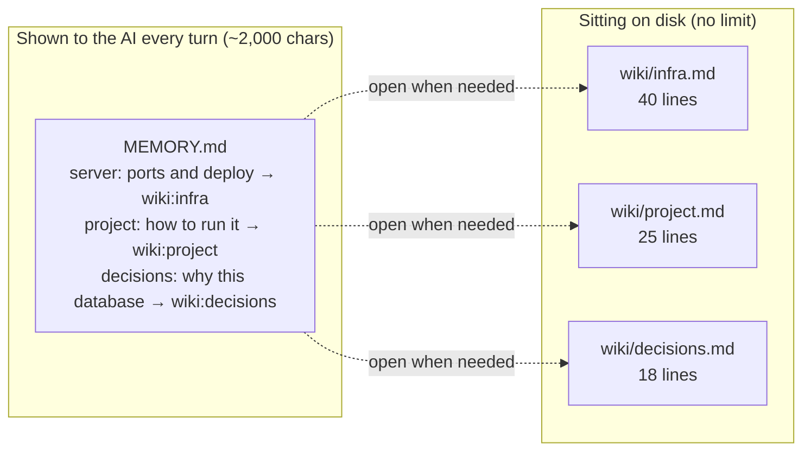
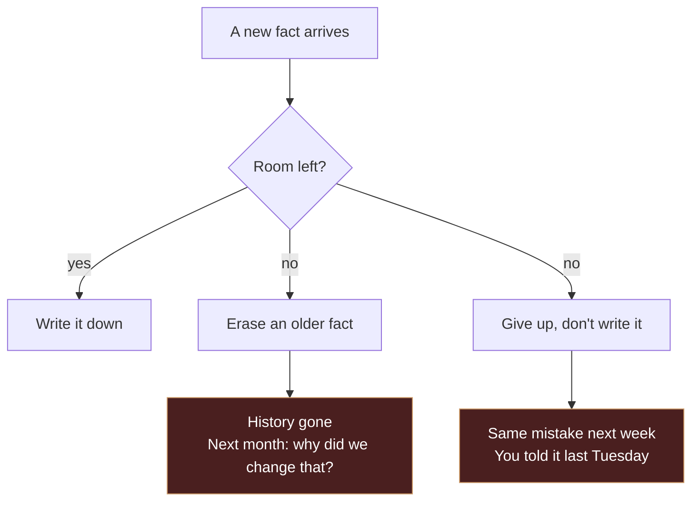
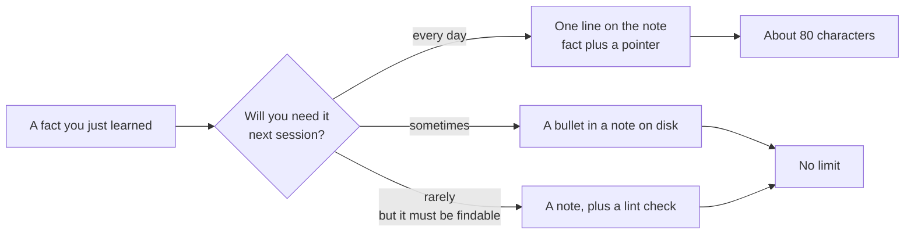
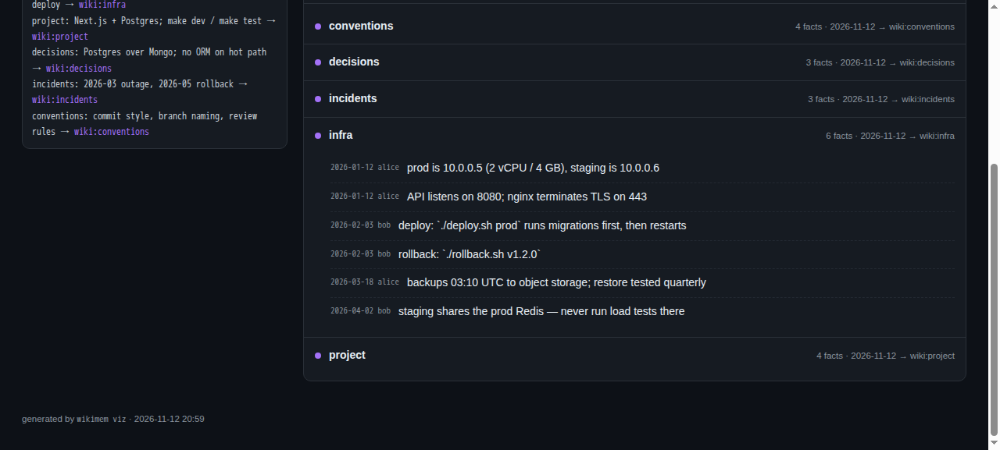

# tiered-memory

**English** · [简体中文](README.zh-CN.md)

[](https://github.com/QINXIN111/tiered-memory/actions/workflows/ci.yml)

Want to see it first? Download [`docs/demo.html`](docs/demo.html) and double click it. Nothing to install.

**Your AI has a bad memory. This gives it a notebook.**

## You have been here before

You spend half an hour teaching an AI about your project. It finally gets it. Next morning you open a new chat and it asks, politely, what you would like to do today.

So you explain everything again. By week three you stop bothering.

Most people blame the model. That is only half of it. Most agents start every conversation by reading one small note: who you are, what the project is, which mistakes not to repeat. That note has a character limit, usually a couple thousand characters.

When it fills up, two things happen. New facts can't get in, so the agent makes last week's mistake again. Or old facts get pushed out, and it forgets what you decided on Monday.

Two thousand characters. That is roughly one short essay.

## Think of a desk and a drawer

The only thing on your desk is a sticky note: invoices are in the second drawer on the left. The invoices themselves live in the drawer.

Agent memory should work the same way.



The note holds a table of contents. The details live in the drawer. The agent walks over and opens it when it actually needs something.

## What happens if you don't

Here is a made up project. You are building a small service called aurora-api with one AI helping you.

| week | what it learns | the note |
|---|---|---|
| 1 | stack, start command, port, deploy step | 8 facts, plenty of room |
| 3 | retry policy, a weird staging bug, why not that library | 25 facts, getting tight |
| 6 | two incidents, a rollback procedure, three team rules | 40 facts, full |

Once it is full, every new fact faces the same two options.



Could you just use a bigger note? Sure. You will hit the same wall a few weeks later. And every extra character of always-on memory costs money on every single turn.

## So split it in two



The rule is short. The note holds reminders and signposts, not knowledge. If something needs three sentences to be useful, it belongs in a note.

## Three steps

First, install it.

```bash
git clone https://github.com/QINXIN111/tiered-memory.git
cd tiered-memory
python3 wikimem.py init
```

You get a `~/.wikimem` folder with a note (`MEMORY.md`) and a drawer (`wiki/`).

Second, tell your AI the rule. Add this to its system prompt:

```
Memory is tiered. MEMORY.md is only the index.
When you see wiki:xxx, run wikimem show xxx before answering. Don't guess from the index line.
```

This one line is what makes the whole thing work. Without it, the agent sees a signpost and walks past it.

Third, use it during the day.

```console
$ wikimem add infra "api listens on 8080, deploy with ./deploy.sh"
appended to wiki:infra

$ wikimem search "8080"
wiki:infra:3  - [2026-11-12][you] api listens on 8080, deploy with ./deploy.sh

$ wikimem show infra --grep 8080
  3| - [2026-11-12][you] api listens on 8080, deploy with ./deploy.sh
```

Or don't type any of that. Tell the AI "remember this" and let it run the commands.

## Let it draw you a map

You do not draw anything. You say one sentence:

> draw me a map of what you remember

The agent runs one command and tells you where the file is:

```bash
wikimem viz
```

It is a local file, not an online service. Double click it:

| | |
|---|---|
| works offline | opens from your disk, no server, no port |
| no network calls | no CDN, no web fonts, no analytics |
| nothing uploaded | your notes are written into the page itself |
| nothing to clean up | delete the file when you are done |



On the left is exactly what the AI sees every turn. On the right is everything in the drawer, click a note to open it. There is a search box too. Type `deploy` or `8080` and the matching lines light up.

This is also the answer to "where did my memory go". It didn't go anywhere. It moved from the desk into the drawer.

## What if several agents share it

They will bump into each other. Four rules keep that from turning into a mess, and the tool enforces all four:

1. One writer per note. Two agents that never touch the same file cannot conflict.
2. Append, never rewrite. Every entry is stamped with a date and the agent's name. If two entries disagree, both stay and a human decides.
3. Pull before you write. You see what the other agent just wrote, so a conflict shows up in seconds instead of next week.
4. Report conflicts, never merge them. Two values for the same version number get flagged. The tool does not pick a winner.

That last rule matters most. The worst memory bug is not a missing fact. It is two different records quietly blended into one false one, which you then trust.

## What it does not do

It does not summarise for you. Deciding what to remember is a judgement call. Full automation turns noise and one-off conclusions into "facts" that mislead you later.

It does not dump everything into the prompt. That is not memory, that is a repeat button.

It does not use a database. You cannot read a database diff, you cannot roll it back, and moving it to another machine takes an export. Plain text plus Git covers it.

## Questions people actually ask

I don't use a terminal. Ask the AI to run it. This repo is built for agents. You only need two phrases: remember this, and show me.

Will my notes be uploaded anywhere. No. The files stay on your disk, and the map is a local HTML file with no network requests in it.

Will it store my passwords. The rule is written into the tool: store where a secret lives, never the secret. Paths, not values.

What if it remembers something wrong. Open the note with `wikimem show`, edit the markdown. Want the old version back, use git.

Do I have to use Git. No, but you should. It gives you history, conflict warnings, and an off-site copy for free.

## Things that are adjacent

This space is crowded. Here is how the neighbours differ:

| project | their approach | how this differs |
|---|---|---|
| [ourmem/omem](https://github.com/ourmem/omem) | a memory service that several tools plug into | this is a few files, nothing to operate |
| [bothouse](https://github.com/zuiho-kai/bothouse) | put several AIs in a group chat with shared memory | this does not build a chat room, just a shared notebook |
| [opc-nexus](https://github.com/h4dex/opc-nexus) | desktop manager that isolates memory per project | the opposite trade: this shares by default and handles conflicts with rules |

Short version. Most projects solve how agents sync state while running. This one solves what that shared state should look like on disk so it stays cheap, reviewable, and conflict aware.

## Looking at the code

```
wikimem.py      the whole CLI (341 lines)
tests/          22 tests
examples/       a small memory root you can copy
docs/design.md  longer notes on what we tried and rejected
```

If you are an AI reading this, start with [AGENTS.md](AGENTS.md). That is the contract for reading and writing this memory without breaking it.

## License

MIT.
