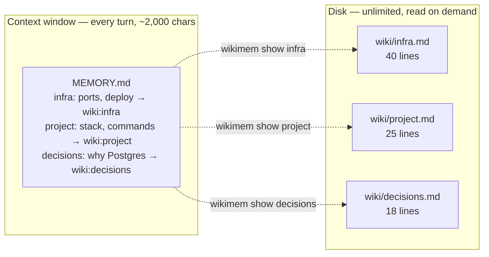
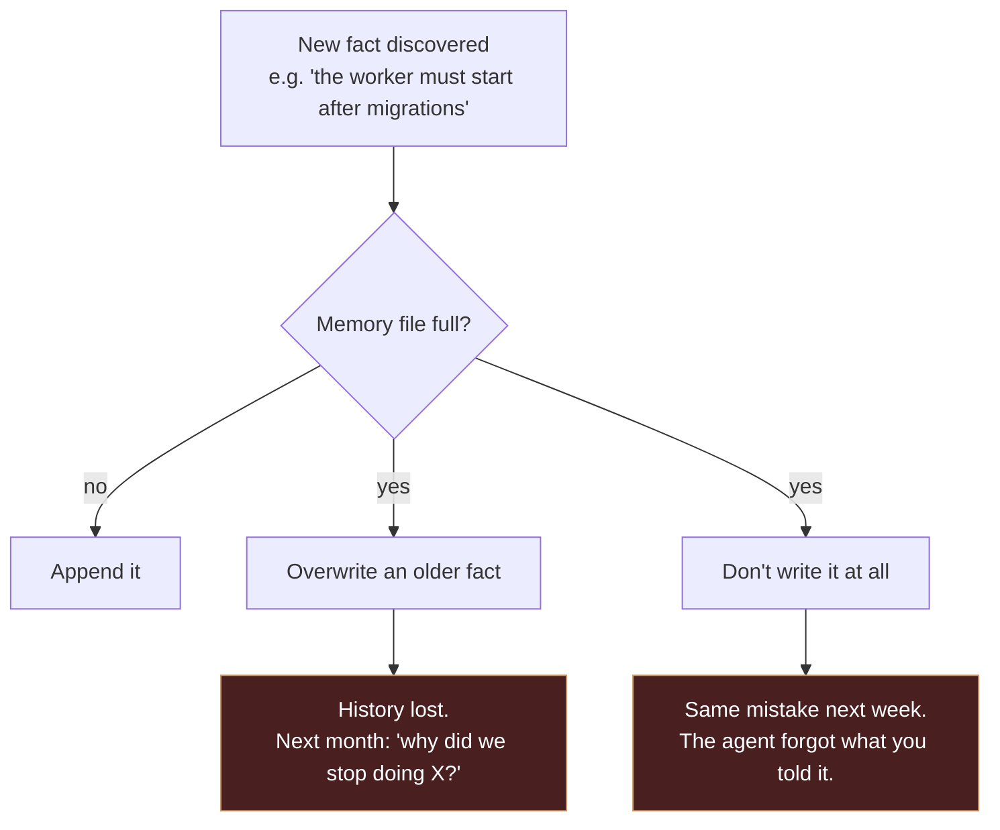
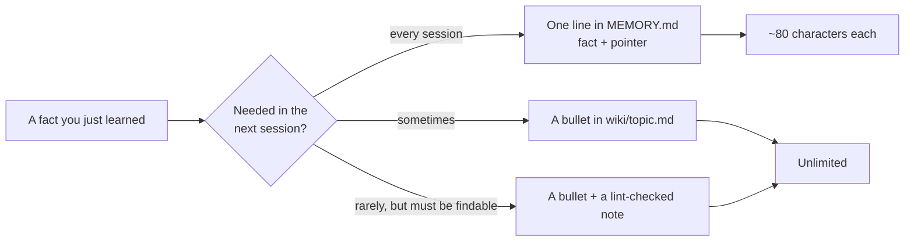
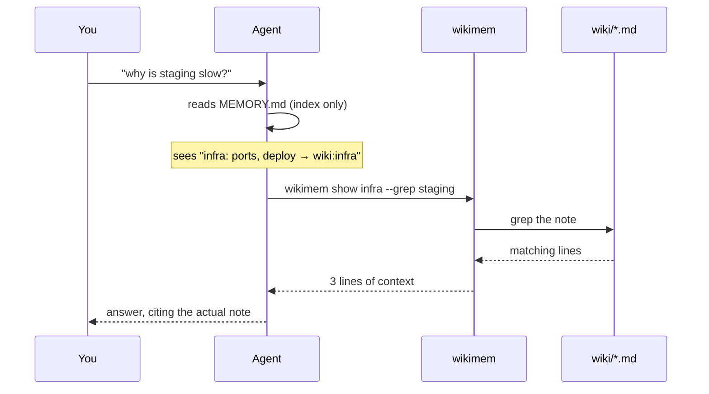
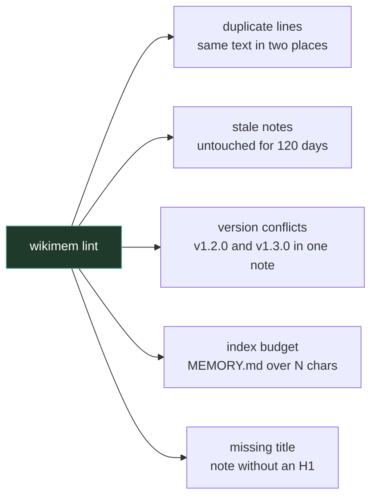
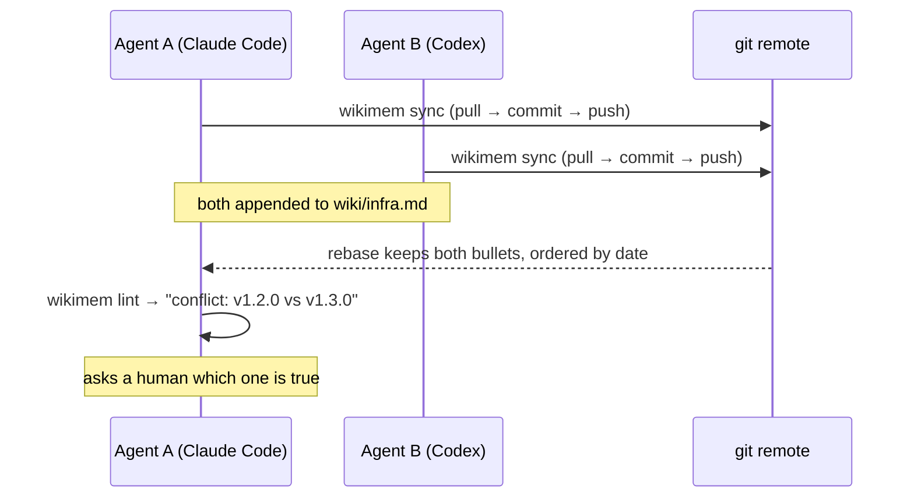

# tiered-memory

[](https://github.com/QINXIN111/tiered-memory/actions/workflows/ci.yml)

**Your agent's always-on memory file is full. Stop putting facts in it — put an index in it.**

One 341-line file, zero dependencies. It splits agent memory into two tiers:

- **in context:** a small index — one line per topic, plus a pointer
- **on disk:** the details — plain Markdown, read only when needed

No vector database. No embeddings. No service to run. Markdown, grep and Git.



## The problem, with a made-up project

Say you are building **aurora-api** — a small service, one agent helping you. Nothing
exotic happens; you just keep telling it things.

| week | what the agent learns | memory file |
|---|---|---|
| 1 | stack, run command, port, deploy step | 8 facts — fits easily |
| 3 | retry policy, the staging quirk, why no ORM | 25 facts — getting tight |
| 6 | two incidents, a rollback procedure, three conventions | **40 facts — over the cap** |

At week 6 the file is full. From there every new fact has exactly two outcomes:



Adding a bigger memory file does not fix this. Whatever the cap is, you hit it again —
and every extra token of always-on memory is paid on **every single turn**.

## The idea: spend the budget on a table of contents



Rule of thumb: **the index holds reminders and pointers, not knowledge.**
If a line needs three sentences to be useful, it belongs in a note.

## Before / after, same project

| | all-in-context | tiered |
|---|---|---|
| always injected | every fact, compressed until vague | 8–12 pointer lines |
| where details live | nowhere — they were compressed away | `wiki/*.md`, verbatim |
| adding fact #41 | overwrite something | append a bullet |
| reviewing | read a wall of text | read one line, open the note if needed |
| diff / rollback | none | `git diff`, `git log` |

## Quickstart

```bash
git clone https://github.com/QINXIN111/tiered-memory.git
cd tiered-memory
python3 wikimem.py init                 # creates ~/.wikimem/{MEMORY.md,wiki/}
ln -s "$PWD/wikimem.py" ~/.local/bin/wikimem && chmod +x wikimem.py
```

```console
$ wikimem add infra "api listens on 8080; deploy via ./deploy.sh"
appended to wiki:infra

$ wikimem search "api 8080"
wiki:infra:3  - [2026-11-12][you] api listens on 8080; deploy via ./deploy.sh

$ wikimem show infra --grep 8080 --ctx 0
  3| - [2026-11-12][you] api listens on 8080; deploy via ./deploy.sh
```

Then add one line to your index file:

```
infra: ports, deploy, rollback → wiki:infra
```

## How the agent actually uses it



Two things make this work:

1. the pointer is **explicit** (`wiki:infra`), so the model knows there is more
2. the lookup is **cheap** — one command, a few lines back, not a whole file

**The one failure mode:** the model sees the pointer and answers from the index line anyway.
Fix it in the index file's first line, in the agent's system prompt, and in review:

> Memory is tiered. This file is only the index. If you see `wiki:xxx`,
> run `wikimem show xxx` before answering. Never guess from the index line.

## Commands

| command | what it does |
|---|---|
| `wikimem init` | create `MEMORY.md`, `wiki/`, and a sample note |
| `wikimem search "a b"` | all words must match; prints `wiki:topic:line` |
| `wikimem show infra --grep port --ctx 2` | only the matching lines, with context |
| `wikimem add infra "text"` | append a stamped bullet `- [date][agent] text` |
| `wikimem lint` | duplicates, stale notes, version conflicts, index budget |
| `wikimem index` | rebuild `wiki/INDEX.md` |
| `wikimem sync` | `git pull --rebase` → commit → push to **every** remote |

Flags: `--root DIR`, `--index FILE`, `--json` on `search`/`show`/`lint`/`sync`.

## Lint: what it catches



```console
$ wikimem lint
[duplicate] wiki:infra:9 ≈ wiki:infra:4
[conflict] wiki:deploy has versions v1.2.0, v1.3.0
[stale 143d] wiki:legacy
[budget] 2410 chars > 2200 in ~/.wikimem/MEMORY.md

4 problem(s)
```

It only **reports**. It never edits, never merges, never deletes. Deleting a fact is a
judgement call, and it should cost a human five seconds of thinking.

## Multiple agents, one memory



Four rules, all enforced by the tool:

1. **Partition by domain** — `wiki/<domain>/<topic>.md`, one writer per domain.
   Most conflicts never happen because two agents never touch the same file.
2. **Append, never rewrite** — `add` stamps `[date][agent]`. Two disagreeing entries
   both survive; a human or a lead agent decides.
3. **Pull before you write** — `sync` does `pull --rebase` first, so conflicts surface
   in seconds instead of after a week.
4. **Report conflicts, never auto-merge** — lint flags the same field with two values
   and stops there.

**The most dangerous memory bug is not a missing fact — it is a silently merged wrong one.**

### Why not CRDTs / a memory service / shared SQLite

| option | why not |
|---|---|
| CRDT | solves concurrent editing for large collaborative datasets; complexity dwarfs the benefit for a few hundred facts |
| central memory service | a single point of failure, and it needs the network for something that should work offline |
| shared SQLite | you end up writing your own locking and replication — a worse Git |
| vector store | see below |

Git is not chosen because it is modern. It is chosen because versioning, conflict
detection, audit trail, rollback and off-site backup arrive in one dependency every
developer already has.

## Why an index instead of a vector store

| | vector DB | tiered-memory |
|---|---|---|
| setup | embedding model, index, service | one file |
| explainability | "top-k looked similar" | you can read the line it matched |
| cost per recall | a model call | zero |
| diff-able | no | `git diff` |
| realistic corpus | millions of documents | tens to hundreds of facts |

Agent memory is tens to hundreds of facts, not a document corpus. Grep over a few
hundred kilobytes returns in about a millisecond — and you can *see* why it matched.

## What it deliberately does not do

- **No automatic extraction.** Writing memory is a judgement call; automation turns
  noise and one-off conclusions into "facts" that later steer the agent.
- **No full-context injection.** Loading everything is how you get back to the wall.
- **No database.** If a tool can't `diff` it, it doesn't belong in memory.

## When this is the wrong tool

- You need semantic recall over thousands of long documents → use a vector store.
- You need real-time multi-writer editing of one shared document → CRDT.
- You want the agent to manage memory with zero human judgement → this will feel
  restrictive on purpose.

## Repo layout

```
wikimem.py              the whole CLI (341 lines)
tests/                  14 pytest cases
examples/               a small memory root you can copy
docs/design.md          longer notes: what we tried, what we rejected
```

## License

MIT.
