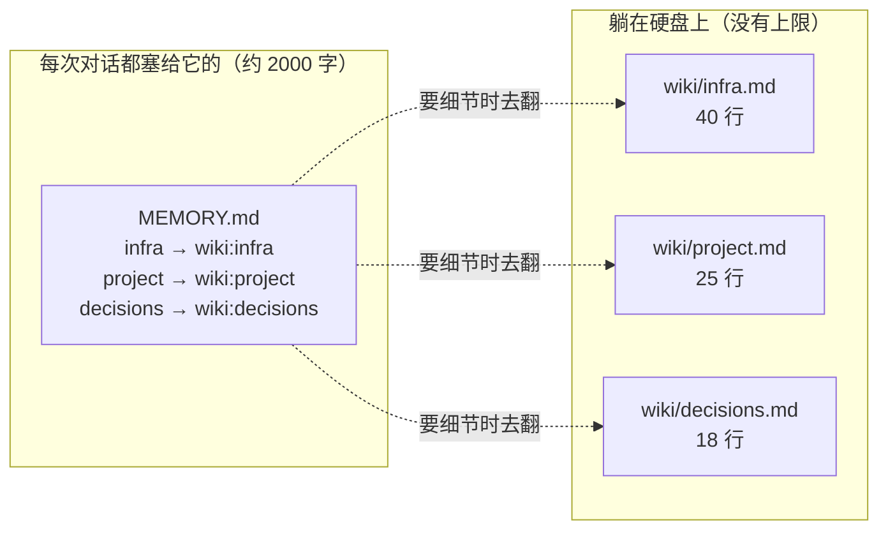
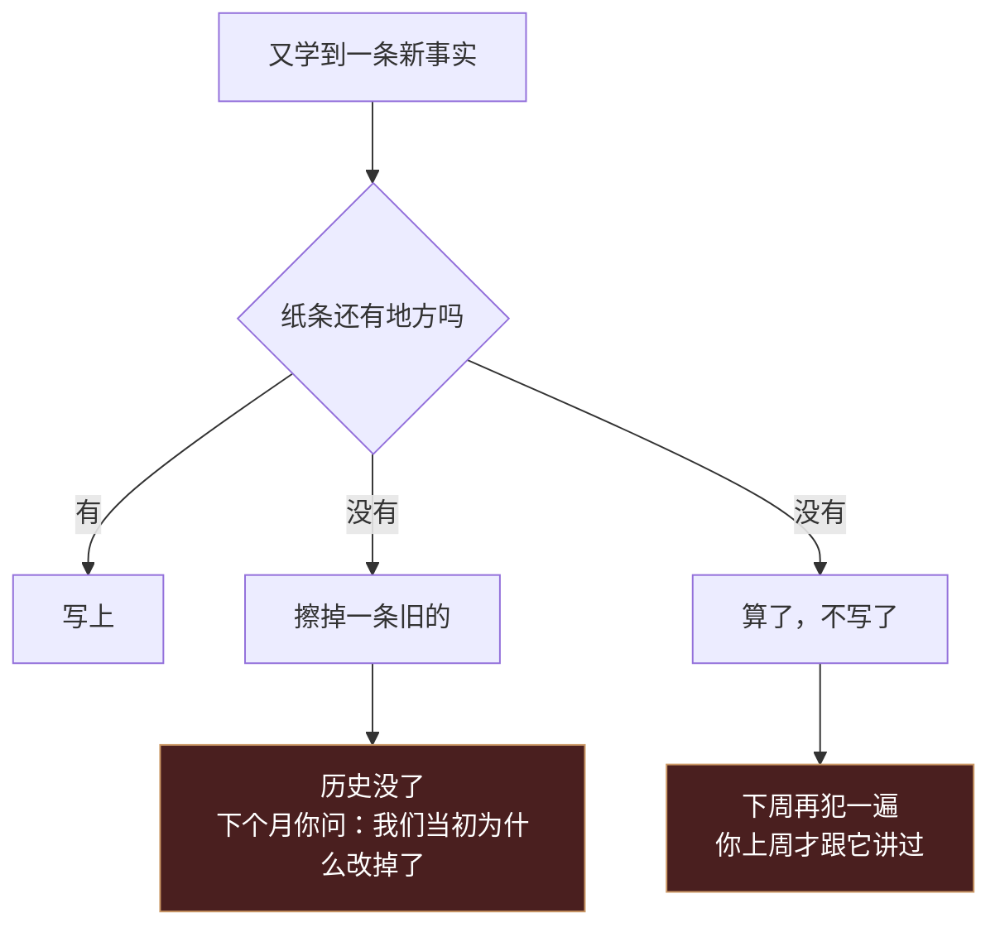
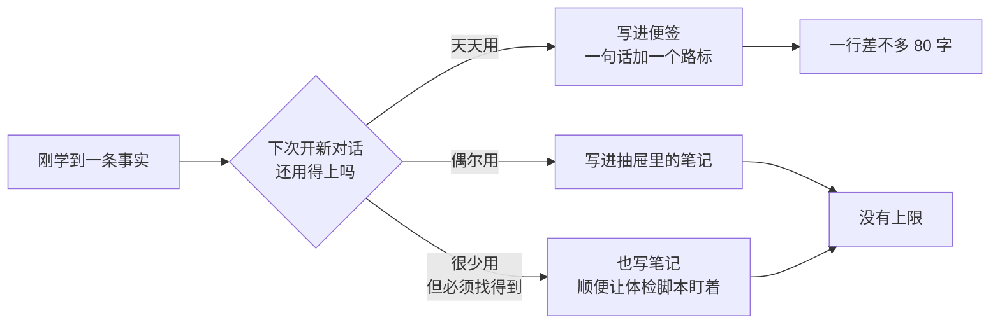
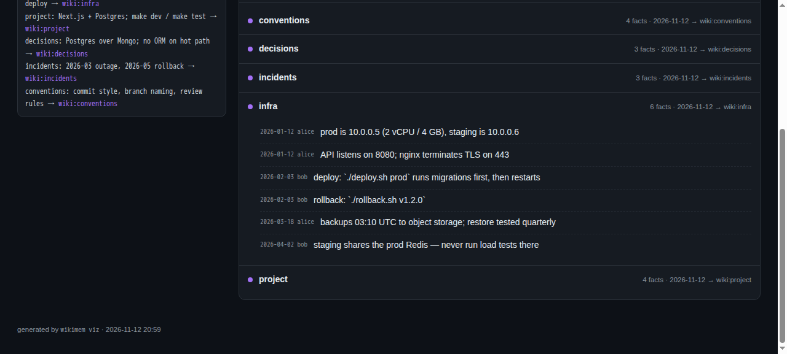

# tiered-memory

[English](README.md) · **简体中文**

[](https://github.com/QINXIN111/tiered-memory/actions/workflows/ci.yml)

想先看看它长什么样？把 [`docs/demo.html`](docs/demo.html) 下载下来双击打开就行，不用装东西。

**你家的 AI 记性不太好。这个工具给它配了个笔记本。**

## 一个你肯定遇到过的场景

你跟 AI 聊了半个钟头，它终于搞懂你的项目了。第二天开新对话，它一脸茫然地问你：请问您想做什么？

你只好把昨天说过的话再说一遍。到第三周，你已经懒得说了。

很多人以为这是模型笨。不全是。大部分 AI 每次开新会话，只会读一张小纸条，上面写着你是谁、项目是什么、哪些坑别踩。这张纸条有字数上限，一般两千字出头。

写满了会出两种事。新的塞不进去，它下周再犯同样的错。或者旧的被挤掉，它忘了你们上周才定好的事。

两千字，大概就是一篇短作文的长度。

## 换个说法：桌面和抽屉

你办公桌上只会放一张便签，写着"发票在左边第二个抽屉"。真正的发票都在抽屉里。

AI 的记忆也该这么放。



便签上只写目录，细节放抽屉。AI 需要的时候自己跑去翻。

## 不这么做的下场

拿个假项目举例。你在做一个叫 aurora-api 的小服务，有一个 AI 帮你。

| 第几周 | 它学到的东西 | 那张纸条 |
|---|---|---|
| 第 1 周 | 技术栈、启动命令、端口、怎么部署 | 8 条，随便写 |
| 第 3 周 | 重试策略、预发环境有个怪毛病、为什么不用某个库 | 25 条，开始挤 |
| 第 6 周 | 两次事故、一套回滚流程、三条团队约定 | 40 条，塞不下 |

塞不下以后，它每学到一条新东西，都只有两个选择。



换个更大的纸条行不行。行，但你会撞上同一堵墙，只是晚几周。而且纸条越大，每聊一句都多花一点钱。

## 所以拆成两层



判断口诀只有一句：便签上放提醒和路标，不放知识本身。一件事要三句才说得清，它就该进抽屉。

## 三步就能用

第一步，装。

```bash
git clone https://github.com/QINXIN111/tiered-memory.git
cd tiered-memory
python3 wikimem.py init
```

跑完会多一个 `~/.wikimem` 文件夹，里面一张便签（`MEMORY.md`）和一个抽屉（`wiki/`）。

第二步，告诉 AI 规矩。在它的系统提示词里加一句：

```
记忆分两层。MEMORY.md 只是目录。
看到 wiki:xxx，先用 wikimem show xxx 打开，别凭目录那行猜。
```

这句话是整个工具能用起来的关键。不加这句，AI 看见路标也不会走。

第三步，平时这样用。

```console
$ wikimem add infra "接口跑在 8080，部署用 ./deploy.sh"
写进 wiki:infra 了

$ wikimem search "8080"
wiki:infra:3  - [2026-11-12][you] 接口跑在 8080，部署用 ./deploy.sh

$ wikimem show infra --grep 8080
  3| - [2026-11-12][you] 接口跑在 8080，部署用 ./deploy.sh
```

当然你也可以什么都不记，直接跟 AI 说"这条记一下"，让它自己去敲命令。

动图版，看完大概十五秒：


## 让它给你画一张

这张图不用你动手。跟 AI 说一句：

> 把你记住的东西画成一张图给我

它会跑一条命令，然后把文件位置告诉你：

```bash
wikimem viz
```

这是个本地文件，不是什么在线服务。双击就开：

| | |
|---|---|
| 不联网 | 从本地文件打开，不起服务、不占端口 |
| 不外传 | 笔记内容直接写在那个网页里，不发给任何人 |
| 不用收拾 | 看完了删掉就行 |



左边是 AI 每次真正看到的那几行。右边是抽屉里的全部内容，点开就是一条条事实。上面还有个搜索框，输入"部署"或者"8080"，命中的行会亮起来。

这也是"我的记忆去哪了"的标准答案。它没丢，只是从桌面挪进抽屉了。

## 几个人一起用会不会打架

会。所以定了四条规矩，工具已经替你执行：

1. 分区域。一个人管一本笔记，别人别碰，大部分冲突根本不会发生。
2. 只往后加，不改旧的。每条前面自动记上日期和是谁写的，两句话打架就都留着，等人来判。
3. 写完之前先拉一下。别人刚写的东西你立刻能看到，冲突当场冒出来，不用等下周。
4. 打架了只报告，不和稀泥。同一个版本号出现两个值，脚本会喊你，不会自己挑一个。

最后这条最要紧。记忆系统最坑的错不是丢了一条，是两条不一样的记录被悄悄合成了一条假的，然后你拿它当真。

## 它不干什么

不自动帮你总结。什么时候记、记什么，得有个判断。全自动的结果是把废话和一次性的结论都存成"事实"，以后天天误导你。

不把所有内容都塞给 AI。那不叫记忆，那叫复读。

不用数据库。数据库里的东西不能用 git 看改动、不能回滚，换台电脑还得导出导入。纯文本加 Git 就够了。

## 常见问题

我不会命令行怎么办。让 AI 帮你跑。这个仓库本来就是给 agent 用的，你只要会说"记一下"和"给我看看"。

我的笔记会被上传吗。不会。文件在你自己的硬盘上，`viz` 生成的那个网页也是本地文件，里面没有任何联网请求。

会不会把密码写进去。规矩写死了一条：只记"在哪"，不记"是什么"。密码和密钥只存路径，不存内容。

记错了怎么办。用 `wikimem show` 看一眼，直接改那个 markdown 文件。想找回旧版本就用 git。

一定要用 Git 吗。不一定要，但建议用。它顺手给了你版本历史、冲突提醒和一份异地备份。

## 差不多的东西还有哪些

这块地方挺挤的。别人怎么做，我们差在哪：

| 项目 | 他们的做法 | 我们的不同 |
|---|---|---|
| [ourmem/omem](https://github.com/ourmem/omem) | 跑一个记忆服务，多个工具接进去 | 我们就是几个文件，没有服务要维护 |
| [bothouse](https://github.com/zuiho-kai/bothouse) | 把几个 AI 拉进一个群聊，共享一份记忆 | 我们不建群，只提供一份共享的笔记本 |
| [opc-nexus](https://github.com/h4dex/opc-nexus) | 桌面管理器，每个项目的记忆互相隔离 | 反过来，我们优先共享，冲突靠规矩解决 |

一句话，别人多在解决"AI 之间怎么在运行时同步"，我们在解决"这份共同的记忆在硬盘上该长什么样，才能既省钱又查得到账"。

## 想自己看看代码

```
wikimem.py     全部命令（341 行）
tests/         22 个测试
examples/      一份可以直接抄的示例
docs/design.md 更长的设计笔记，包括我们否决过什么
```

如果你自己就是 AI，先读 [AGENTS.md](AGENTS.md)，那里写了读写这套记忆的规矩。

## 许可

MIT。拿去用，改，商用都行。
