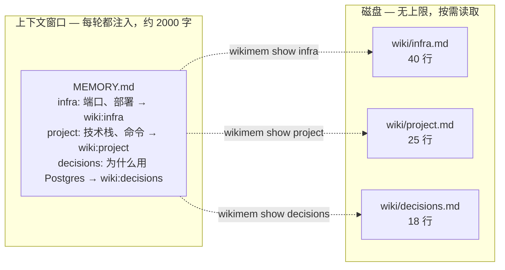
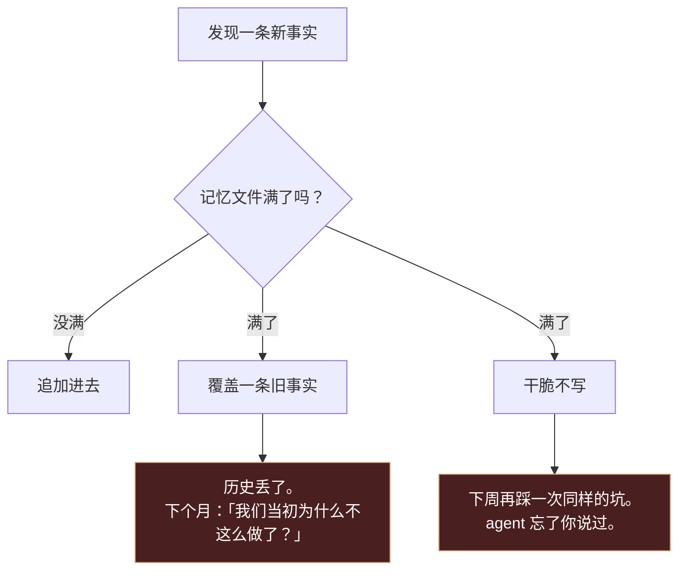
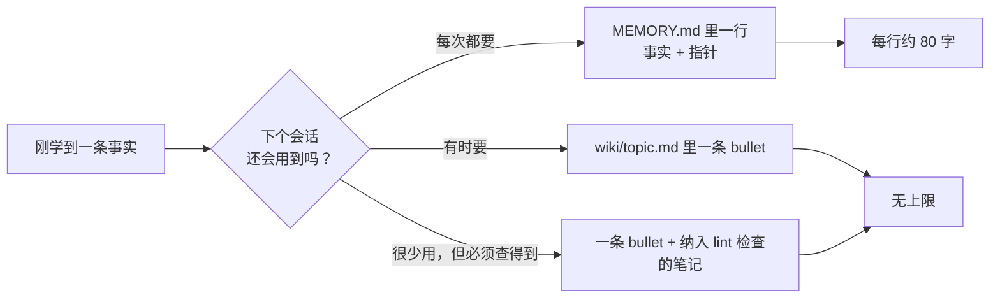
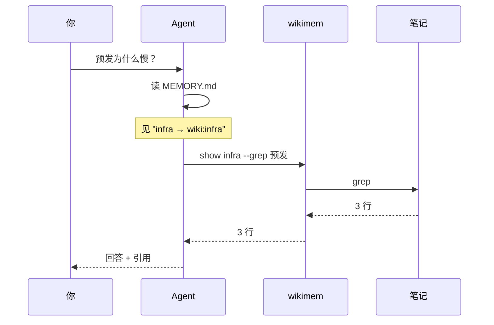
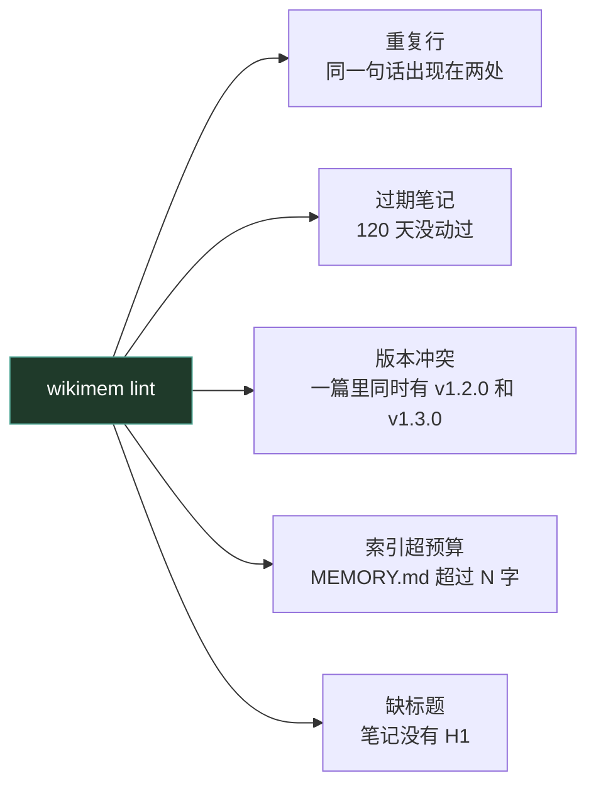
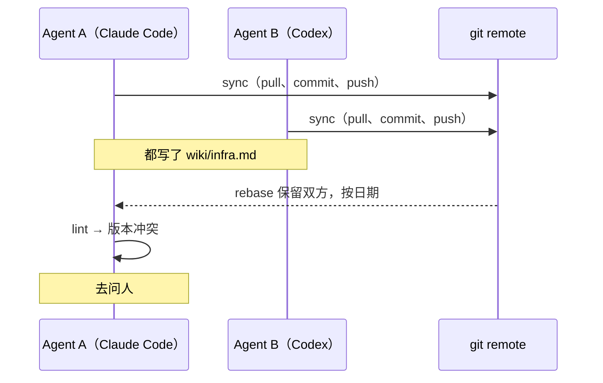

# tiered-memory · 分层记忆

[](https://github.com/QINXIN111/tiered-memory/actions/workflows/ci.yml)

**你的 agent 常驻记忆文件满了。别再往里塞事实——往里放目录。**

一个零依赖的 341 行脚本，把 agent 记忆拆成两层：

- **进上下文**：一份小索引，一行一个主题 + 一个指针
- **落磁盘**：真正的细节，纯 Markdown，用时才读

不用向量库、不用嵌入模型、不用起服务。就是 Markdown + grep + Git。



## 问题：拿一个虚构项目说

假设你在写 **aurora-api**，一个小服务，一个 agent 帮你。没有什么离奇的事发生，
你只是一直在告诉它东西。

| 周 | agent 学到了什么 | 记忆文件 |
|---|---|---|
| 第 1 周 | 技术栈、启动命令、端口、部署步骤 | 8 条 —— 轻松装下 |
| 第 3 周 | 重试策略、预发环境的怪癖、为什么不用 ORM | 25 条 —— 开始紧张 |
| 第 6 周 | 两次事故、一套回滚流程、三条约定 | **40 条 —— 超出上限** |

第 6 周文件满了。举个具体的例子：agent 学到「worker 必须在迁移之后启动」。从这一刻起，
这条事实只有两种结局：



把记忆文件改大并不能解决它。上限是多少，你就会在第多少次撞上它 ——
而且常驻记忆每多一个 token，是**每一轮对话**都要付的。

## 思路：把预算花在目录上



判断口诀：**索引里放的是「提醒」和「指针」，不是知识本身。**
如果一行话需要三句才说得清，它就该进笔记。

## 同一个项目，前后对比

| | 全部塞上下文 | 分层 |
|---|---|---|
| 每轮注入 | 每条事实都被压缩到模糊 | 8–12 行指针 |
| 细节在哪 | 哪儿都没有——被压缩掉了 | `wiki/*.md`，原文 |
| 加第 41 条事实 | 覆盖某一条 | 追加一条 bullet |
| 复盘记忆 | 读一大坨文字 | 读一行，需要再打开笔记 |
| diff / 回滚 | 没有 | `git diff`、`git log` |

## 快速开始

```bash
git clone https://github.com/QINXIN111/tiered-memory.git
cd tiered-memory
python3 wikimem.py init                 # 生成 ~/.wikimem/{MEMORY.md,wiki/}
ln -s "$PWD/wikimem.py" ~/.local/bin/wikimem && chmod +x wikimem.py
```

```console
$ wikimem add infra "api 监听 8080；用 ./deploy.sh 部署"
appended to wiki:infra

$ wikimem search "api 8080"
wiki:infra:3  - [2026-11-12][you] api 监听 8080；用 ./deploy.sh 部署

$ wikimem show infra --grep 8080 --ctx 0
  3| - [2026-11-12][you] api 监听 8080；用 ./deploy.sh 部署
```

然后在索引文件里加一行：

```
infra: 端口、部署、回滚 → wiki:infra
```

## agent 实际是怎么用的



两件事让它成立：

1. 指针是**显式**的（`wiki:infra`），模型知道自己还有东西没看
2. 查询**足够便宜** —— 一条命令、几行返回，不是整个文件

**唯一的失败模式**：模型看见指针，直接用索引行回答。
所以在索引文件第一行、agent 的系统提示词、review 清单里各写一遍：

> 记忆是分层的，这个文件只是目录。看到 `wiki:xxx`，
> 先跑 `wikimem show xxx` 再回答，不要凭索引行猜。

## 命令

| 命令 | 作用 |
|---|---|
| `wikimem init` | 建 `MEMORY.md`、`wiki/` 和一篇示例 |
| `wikimem search "a b"` | 多词 AND，输出 `wiki:topic:行号` |
| `wikimem show infra --grep port --ctx 2` | 只看命中行附近 |
| `wikimem add infra "一句话"` | 追加带日期与署名的条目 `- [日期][agent] …` |
| `wikimem lint` | 重复 / 未更新 / 版本冲突 / 索引超预算 |
| `wikimem index` | 重建 `wiki/INDEX.md` |
| `wikimem sync` | pull --rebase → commit → 推送到**所有** remote |

通用参数：`--root DIR`、`--index FILE`；`search`/`show`/`lint`/`sync` 支持 `--json`。

## lint 能抓什么



```console
$ wikimem lint
[duplicate] wiki:infra:9 ≈ wiki:infra:4
[conflict] wiki:deploy has versions v1.2.0, v1.3.0
[stale 143d] wiki:legacy
[budget] 2410 chars > 2200 in ~/.wikimem/MEMORY.md

4 problem(s)
```

它只**报告**，不改、不合并、不删除。删一条记忆是个判断，
应该让人花五秒钟想一下。

## 多个 agent，共用一份记忆



四条规则，工具替你执行：

1. **按域分区** —— `wiki/<domain>/<topic>.md`，一个域一个写者。
   两个 agent 不碰同一个文件，大部分冲突根本不会发生。
2. **只追加，不改写** —— `add` 自动盖 `[日期][agent]`。两条互相矛盾的说法都留着，
   由人或主 agent 裁决。
3. **写前先拉** —— `sync` 先 `pull --rebase`，冲突在秒级暴露，而不是攒一周。
4. **冲突只报告，不自动合并** —— lint 发现同一字段两个值就停在那里。

> 记忆系统最危险的 bug 不是「缺了一条」，是「两条错的值被安静地合并了」。

### 为什么不用 CRDT / 中心记忆服务 / 共享 SQLite

| 方案 | 为什么不用 |
|---|---|
| CRDT | 为大规模协作编辑设计的；几百条事实用不上，复杂度远超收益 |
| 中心记忆服务 | 单点故障，而且本来该离线可用的东西被绑上了网络 |
| 共享 SQLite | 最后你要自己写锁和复制——等于做一个更差的 Git |
| 向量库 | 见下 |

选 Git 不是因为它先进，是因为**版本、冲突检测、审计、回滚、异地备份**
一次性都给你了，而且是每个开发者本来就有的依赖。

## 为什么是索引，不是向量库

| | 向量库 | tiered-memory |
|---|---|---|
| 安装 | 嵌入模型 + 索引 + 服务 | 一个文件 |
| 可解释 | "top-k 看起来像" | 直接看命中的那一行 |
| 每次召回成本 | 一次模型调用 | 0 |
| 可 diff | 否 | `git diff` |
| 适用规模 | 百万级文档 | 几十到几百条事实 |

agent 的记忆是几十到几百条事实，不是文档库。几百 KB 的 grep 大约一毫秒，
而且你能**看见**它为什么命中。

## 它故意不做的事

- **不自动抽取记忆**：写入是判断题；自动化会把噪声和一次性结论沉淀成"事实"，
  之后反过来带偏 agent
- **不全量注入**：全都塞进去，就回到了那堵墙
- **不用数据库**：不能 `diff` 的东西，不配进记忆

## 什么情况下别用它

- 你要在几千篇长文档里做语义召回 → 用向量库
- 你要多人实时共编一份文档 → 用 CRDT
- 你希望 agent 完全自动管理记忆、不需要人判断 → 它会显得很受限，这是故意的

## 仓库结构

```
wikimem.py              整个 CLI（341 行）
tests/                  14 个 pytest 用例
examples/               可以直接抄的一小份记忆根目录
docs/design.md          更长的设计笔记：试过什么、否决了什么
```

## 协议

MIT。
